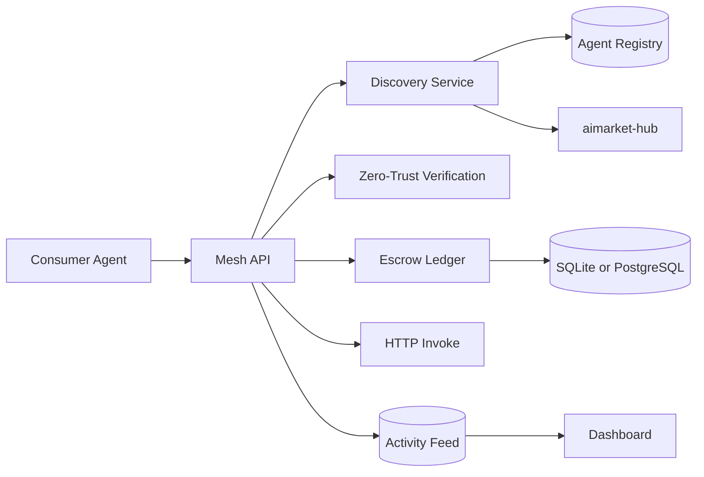

# Architecture — AI Service Mesh

## Overview

AI Service Mesh is a **control plane** for agent-to-agent commerce. It does not replace LLM inference; it coordinates **who** executes work, which registration and endpoint checks apply, and how a task amount is held in the internal USD ledger.

## Components

### Mesh API (`ai_service_mesh/api.py`)

FastAPI application with an origin allowlist, bearer authentication for write routes, rate limiting and security headers. Exposes REST + SSE activity stream.

### Discovery (`discovery.py`)

1. **Local registry** — verified agents with capability matching and trust-weighted scoring.
2. **Federated hub** — optional `MESH_HUB_URL` search against AIMarket v2 (`/ai-market/v2/search`).

### Verification (`verification.py`)

Zero-trust registration checks:

- HTTPS endpoint with DNS-resolving SSRF guard (same class of protection as `aimarket-hub` crawler).
- Valid PEM public key (RSA or Ed25519).
- Ed25519 or RSA signature over canonical agent metadata, proving possession of the submitted key.

Local agents start `pending` and move to `verified` after verification. The Hub path consumes Hub search metadata and checks its manifest before invocation.

### Orchestrator (`orchestrator.py`)

Tries matching candidates within the task budget. Local calls check `/health` before `/invoke`. Hub calls check `/ai-market/v2/manifest` before `/ai-market/v2/invoke`.

| Phase | Activity event |
|-------|----------------|
| Discovery | `mesh.discovery` |
| Verification | `mesh.verification` |
| Escrow | `mesh.escrow` |
| Invoke | `mesh.invoke` |
| Settle | `mesh.settle` |

### Payments (`payments.py`)

Mesh persists USD-denominated holds in SQLite or PostgreSQL. An accepted invocation releases its hold. A failed invocation marks the hold refunded and allows the Mesh to try the next candidate. These are internal accounting entries. On-chain settlement is a separate AIMarket Hub flow. Wallet binding is optional and disabled by default.

### Persistence (`db.py`, `db_backend.py`)

Same pattern as **AIMarket Hub**: SQLite by default (`MESH_DATA_DIR/mesh.db`), PostgreSQL when `MESH_DATABASE_URL` or `DATABASE_URL` is set. DDL is SQLite-first; `sqlite_to_pg()` translates at runtime. Migrate existing data with `scripts/migrate_sqlite_to_postgres.py`.

## Deployment topology

| Tier | Stack |
|------|--------|
| Dev | Single process + SQLite + Vite dashboard |
| Prod | Docker Compose: loopback API and static dashboard, TLS edge, optional PostgreSQL |
